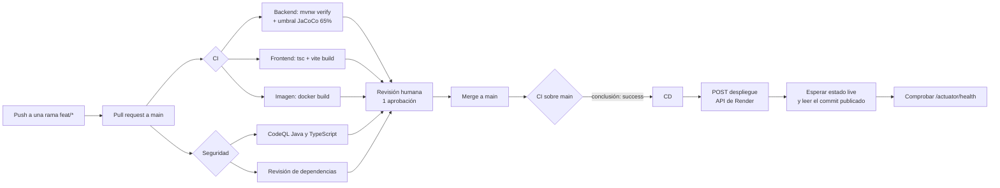

# CI/CD con GitHub Actions — Sprint 2

Entregable de arquitectura: *CI/CD inicial con GitHub Actions* e *identificación de
vulnerabilidades con OWASP Top Ten*. Este documento describe el pipeline que vive en
`.github/`, qué valida cada etapa, qué hay que configurar una sola vez en GitHub y en
Render, y dónde queda la evidencia para la sustentación.

## 1. Vista general

**El pipeline es el único que despliega**, y la razón es empírica. Los servicios de
Render tienen `autoDeploy` activo, pero nunca se disparó un despliegue por un commit: en
veinte días el historial mostró dos despliegues, ambos pedidos a mano o por API, mientras
se pusheaba a la rama que esos servicios seguían. La cuenta de Render no recibe los
eventos de push de GitHub, probablemente porque los servicios se crearon por API contra
la URL pública del repositorio, sin la aplicación de GitHub de Render conectada: puede
clonar y construir, pero no le llega el aviso.

Eso dejó una lección que está grabada en el diseño de `cd.yml`: **la primera versión de
este workflow solo consultaba `/actuator/health`, y daba verde mientras el servicio
publicado corría código de tres semanas antes**. Un servicio vivo con una versión vieja
responde `UP` igual que uno recién desplegado. La salud mide disponibilidad, no
actualidad. Por eso ahora el despliegue se pide por la API de Render y se espera su
estado real, con el commit publicado como evidencia; la salud quedó como comprobación
final, no como la única.

Como el despliegue cuelga del resultado de CI, `main` en rojo no llega a producción. La
regla de protección de rama de la sección 3 sigue siendo necesaria, pero ahora refuerza
al pipeline en vez de ser lo único que lo sostiene.

## 2. Los tres workflows

### `ci.yml` — Integración continua

Se dispara en cada pull request a `main`, en cada push a `main` y a mano
(`workflow_dispatch`). Tres trabajos en paralelo:

| Trabajo | Qué hace | Por qué importa |
|---------|----------|-----------------|
| `backend` | `./mvnw -B -ntp verify` con JDK 21 y caché de Maven | Ejecuta las pruebas unitarias y las de integración (Testcontainers usa el Docker preinstalado del runner) y aplica el umbral de cobertura de líneas del `pom.xml`. Si la cobertura baja del 65%, el build falla. |
| `frontend` | `npm ci`, `npm run typecheck`, `npm run build` | Un error de tipos o un empaquetado roto se detecta antes del merge, no en el navegador. |
| `imagen` | `docker build` del `Dockerfile`, sin publicar | Es exactamente la imagen que construye Render. Un Dockerfile roto se descubre aquí y no en el despliegue. |

Cada ejecución publica en el resumen del job el porcentaje de cobertura de líneas, y
guarda como artefactos los reportes de Surefire y el HTML de JaCoCo durante 7 días. Eso
es la evidencia de pruebas del sprint sin tener que clonar nada.

Un push nuevo sobre la misma rama cancela la ejecución anterior (`concurrency`): no se
gastan minutos revisando código ya reemplazado.

### `seguridad.yml` — Vulnerabilidades (OWASP Top Ten)

Se dispara igual que CI, y además cada lunes a las 06:00 UTC, porque aparecen CVE nuevos
sobre código que no cambió.

| Trabajo | Herramienta | Categorías del OWASP Top Ten que ataca |
|---------|-------------|----------------------------------------|
| `codeql` | CodeQL con el conjunto `security-and-quality`, matriz `java-kotlin` y `javascript-typescript` | A01 control de acceso roto, A03 inyección, A07 fallos de identificación y autenticación, A08 fallos de integridad, A09 fallos de registro y monitoreo. |
| `dependencias` | `actions/dependency-review-action`, falla con severidad `high` | A06 componentes vulnerables y desactualizados. Bloquea el PR que introduzca una dependencia con vulnerabilidad conocida. |

`dependabot.yml` completa el cuadro por el lado preventivo: propone actualizaciones
semanales de Maven, npm y la imagen base del `Dockerfile`, y mensuales de las propias
acciones de GitHub. La revisión de dependencias bloquea; Dependabot propone el parche.

Dos reglas de convivencia que salieron de la primera ejecución, cuando abrió siete pull
requests de una sola vez:

- **Agrupado por ecosistema** (`groups`): todas las actualizaciones de un ecosistema
  llegan en un solo PR. Sin esto, la primera corrida sobre un repositorio sin historial
  de Dependabot abre un PR por dependencia y el tablero queda inutilizable.
- **Los saltos de versión mayor quedan ignorados**, salvo en las propias acciones de
  GitHub, que son el andamio del pipeline y no el producto. Un major no es una
  actualización, es una migración, y se decide a mano: las dos propuestas que motivaron
  la regla querían llevar la imagen base de Java 21 a 25 y TypeScript de 5 a 7, con el
  `pom.xml` fijado en `java.version` 21.

La contrapartida se asume a conciencia: si la corrección de una vulnerabilidad solo
existe en una versión mayor, Dependabot no va a proponerla. La alerta igual aparece en
**Security → Dependabot alerts**, y desde ahí se decide la migración.

Los hallazgos quedan en la pestaña **Security → Code scanning** del repositorio. Esa
pestaña, con sus alertas y su historial, es la evidencia del entregable: no hace falta
redactar el inventario a mano.

### `cd.yml` — Despliegue continuo

No escucha pushes: escucha el **resultado** de CI (`workflow_run`). Corre cuando CI
concluye con `success` sobre `main`, y también a mano (`workflow_dispatch`) para
redesplegar sin inventar un commit vacío. En los dos casos hace lo mismo, en tres pasos:

1. **Pide el despliegue** de cada servicio por la API de Render
   (`POST /v1/services/{id}/deploys`), que devuelve el identificador del despliegue.
2. **Espera el estado real** consultando ese despliegue cada 20 segundos, hasta 30
   minutos, y exige que termine en `live`. Si termina en `build_failed`,
   `update_failed`, `canceled` o `deactivated`, el trabajo falla.
3. **Comprueba la salud** del backend en `/actuator/health`.

El paso 2 es el que da la garantía, y el paso 3 por sí solo no la da: un servicio vivo
corriendo una versión de hace tres semanas responde `UP` igual que uno recién
desplegado. El resumen del trabajo publica el estado de cada servicio y el commit que
quedó en producción, que es la evidencia de que lo desplegado es lo que se mergeó.

Render despliega la punta de la rama. Si alguien mergea entre que CI termina y CD
arranca, la punta se movió y el commit publicado no coincide con el esperado: eso se
informa como advertencia y no como fallo, porque ya viene otro despliegue en camino.

La lógica vive en `.github/scripts/desplegar_render.py`, no incrustada en el YAML, para
poder ejecutarla y probarla fuera del runner. No usa dependencias externas: solo la
biblioteca estándar de Python.

**El despliegue se pide siempre con la caché de capas limpia**, y esto viene de un
incidente concreto. El despliegue del commit `bd22d67` quedó en estado `live` mientras la
aplicación servía el código del sprint anterior: 17 rutas en lugar de 22, y Flyway
reportando «validated 2 migrations» con un esquema en versión 2 cuando el commit traía
`V3__historial_servicios.sql`. Se verificó que el commit sí contenía la migración y los
controladores nuevos, y que la construcción había usado el `Dockerfile` correcto; lo único
que publicó el código correcto fue reconstruir sin caché, y ahí Flyway sí registró
«Migrating schema "public" to version "3 - historial servicios"».

El costo está medido y es nulo: la construcción con caché tardó 49 segundos y la limpia
47. Entre no ahorrar nada y publicar una versión vieja sin darse cuenta, la elección es
obvia.

Los márgenes de reintento no son arbitrarios. El plan gratuito suspende el servicio por
inactividad y el arranque en frío tarda cerca de un minuto: está medido, la primera
consulta de salud no responde y recién el tercer intento devuelve `UP`.

El trabajo usa el *environment* `produccion`: si más adelante quieren aprobación manual
antes de publicar, se activa en la configuración del environment sin tocar el YAML.

## 3. Configuración de una sola vez

### Secretos y variables del repositorio

En **Settings → Secrets and variables → Actions**:

| Nombre | Tipo | Valor |
|--------|------|-------|
| `RENDER_API_KEY` | Secret | Clave de la API de Render. Se crea en **Account Settings → API Keys**. Es la única credencial que CD necesita. |
| `RENDER_SERVICIOS` | Variable | Opcional. Lista `nombre=idServicio` separada por comas. Si no se define, el workflow usa los identificadores de los servicios actuales. |
| `URL_SALUD_BACKEND` | Variable | Opcional. URL de salud. Si no se define, el workflow usa `https://reservaya-vvke.onrender.com/actuator/health`. |

La clave de la API da acceso a toda la cuenta de Render, así que va como *secret* y
nunca como variable. Los identificadores de servicio, en cambio, no son secretos: son
visibles en la URL del panel, y tenerlos en el YAML documenta a qué se despliega.

Los deploy hooks que se usaban antes ya no hacen falta: la API cumple la misma función y
además devuelve el identificador del despliegue, que es lo que permite seguir su estado.
Si quedaron cargados como secretos, se pueden borrar.

### Render

Los dos servicios deben seguir la rama `main`, que es la que CI valida:

| Servicio | Tipo | Rama |
|----------|------|------|
| `reservaya` | Web service (Docker) | `main` |
| `reservaya-web` | Static site | `main` |

Esto importa más de lo que parece. Durante el Sprint 2 los dos servicios siguieron la
rama `feat/sprint1-backend-reservas` mientras el equipo mergeaba a `main`: lo desplegado
no correspondía a nada de lo que se estaba revisando, y nadie lo notó porque el servicio
respondía con salud.

El `autoDeploy` del panel puede quedar como esté: el despliegue lo pide el pipeline por
API, y como ese evento de push nunca llega a Render, no hay riesgo de despliegue doble.

### Protección de la rama `main`

Los lineamientos exigen PR con al menos una aprobación y pipeline en verde. En
**Settings → Branches → Add rule** sobre `main`:

- Require a pull request before merging, con 1 aprobación.
- Require status checks to pass: `Backend — pruebas y cobertura`,
  `Frontend — tipos y empaquetado`, `Imagen de contenedor`, `Revisión de dependencias`.
- Require branches to be up to date before merging.
- Require conversation resolution before merging.

Sin esta regla el pipeline informa pero no protege: cualquiera puede mergear en rojo.

## 4. Un detalle de orden que hay que tener en cuenta

Los workflows disparados por `pull_request` sí corren desde la rama del PR: el primer PR
que incluya `.github/` ya ejecuta CI y Seguridad. Pero `workflow_run` **solo existe
cuando el workflow ya está en la rama por defecto**: CD empieza a funcionar recién
después del primer merge a `main`. Es el comportamiento normal de GitHub Actions, no un
error de configuración.

## 5. Qué queda fuera, a propósito

- **SonarCloud y el quality gate**: es el 25% de la rúbrica y lo trabaja el equipo de
  calidad. Cuando tengan el token, se agrega un trabajo a `ci.yml` que ejecute
  `sonar:sonar` reusando el reporte de JaCoCo que ya se genera.
- **Publicación de la imagen en un registro**: hoy Render construye desde el
  `Dockerfile`, así que publicar la imagen no aporta nada todavía.
- **Pruebas de carga y de contrato**: no están en el alcance del Sprint 2.
