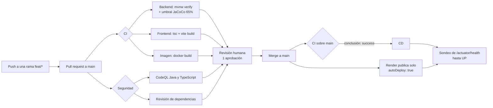

# CI/CD con GitHub Actions — Sprint 2

Entregable de arquitectura: *CI/CD inicial con GitHub Actions* e *identificación de
vulnerabilidades con OWASP Top Ten*. Este documento describe el pipeline que vive en
`.github/`, qué valida cada etapa, qué hay que configurar una sola vez en GitHub y en
Render, y dónde queda la evidencia para la sustentación.

## 1. Vista general

Render conserva el despliegue automático (`autoDeploy: true`): publica por su cuenta
cada push a `main`, en paralelo con CI. Conviene tener claro lo que eso implica: **el
despliegue no está condicionado al pipeline**. Si alguien mergea con CI en rojo, Render
publica igual, y CD lo único que hará es dejar constancia de que el servicio quedó
arriba o caído. Lo que de verdad protege `main` en este esquema es la regla de
protección de rama de la sección 3: si no se puede mergear en rojo, no se puede
desplegar en rojo.

## 2. Los tres workflows

### `ci.yml` — Integración continua

Se dispara en cada pull request a `main`, en cada push a `main` y a mano
(`workflow_dispatch`). Tres trabajos en paralelo:

| Trabajo | Qué hace | Por qué importa |
|---------|----------|-----------------|
| `backend` | `./mvnw -B -ntp verify` con JDK 21 y caché de Maven | Ejecuta las pruebas unitarias y las de integración (Testcontainers usa el Docker preinstalado del runner) y aplica el umbral de cobertura de líneas del `pom.xml`. Si la cobertura baja del 65%, el build falla. |
| `frontend` | `npm ci`, `npm run typecheck`, `npm run build` | Un error de tipos o un empaquetado roto se detecta antes del merge, no en el navegador. |
| `imagen` | `docker build` del `Dockerfile`, sin publicar | Es exactamente la imagen que construye Render. Un Dockerfile roto se descubre aquí y no en el despliegue. |

Cada ejecución publica en el resumen del job el porcentaje de cobertura de líneas, y
guarda como artefactos los reportes de Surefire y el HTML de JaCoCo durante 7 días. Eso
es la evidencia de pruebas del sprint sin tener que clonar nada.

Un push nuevo sobre la misma rama cancela la ejecución anterior (`concurrency`): no se
gastan minutos revisando código ya reemplazado.

### `seguridad.yml` — Vulnerabilidades (OWASP Top Ten)

Se dispara igual que CI, y además cada lunes a las 06:00 UTC, porque aparecen CVE nuevos
sobre código que no cambió.

| Trabajo | Herramienta | Categorías del OWASP Top Ten que ataca |
|---------|-------------|----------------------------------------|
| `codeql` | CodeQL con el conjunto `security-and-quality`, matriz `java-kotlin` y `javascript-typescript` | A01 control de acceso roto, A03 inyección, A07 fallos de identificación y autenticación, A08 fallos de integridad, A09 fallos de registro y monitoreo. |
| `dependencias` | `actions/dependency-review-action`, falla con severidad `high` | A06 componentes vulnerables y desactualizados. Bloquea el PR que introduzca una dependencia con vulnerabilidad conocida. |

`dependabot.yml` completa el cuadro por el lado preventivo: propone actualizaciones
semanales de Maven, npm y la imagen base del `Dockerfile`, y mensuales de las propias
acciones de GitHub. La revisión de dependencias bloquea; Dependabot propone el parche.

Dos reglas de convivencia que salieron de la primera ejecución, cuando abrió siete pull
requests de una sola vez:

- **Agrupado por ecosistema** (`groups`): todas las actualizaciones de un ecosistema
  llegan en un solo PR. Sin esto, la primera corrida sobre un repositorio sin historial
  de Dependabot abre un PR por dependencia y el tablero queda inutilizable.
- **Los saltos de versión mayor quedan ignorados**, salvo en las propias acciones de
  GitHub, que son el andamio del pipeline y no el producto. Un major no es una
  actualización, es una migración, y se decide a mano: las dos propuestas que motivaron
  la regla querían llevar la imagen base de Java 21 a 25 y TypeScript de 5 a 7, con el
  `pom.xml` fijado en `java.version` 21.

La contrapartida se asume a conciencia: si la corrección de una vulnerabilidad solo
existe en una versión mayor, Dependabot no va a proponerla. La alerta igual aparece en
**Security → Dependabot alerts**, y desde ahí se decide la migración.

Los hallazgos quedan en la pestaña **Security → Code scanning** del repositorio. Esa
pestaña, con sus alertas y su historial, es la evidencia del entregable: no hace falta
redactar el inventario a mano.

### `cd.yml` — Despliegue continuo

No escucha pushes: escucha el **resultado** de CI (`workflow_run`). Tiene dos caminos:

| Disparo | Qué hace |
|---------|----------|
| Automático, cuando CI concluye con `success` sobre `main` | Sondea `/actuator/health` cada 20 segundos, hasta 30 veces, y exige `status: UP`. No dispara nada: de desplegar ya se encargó Render. |
| Manual (`workflow_dispatch`) | Dispara los deploy hooks del backend y del frontend, y después verifica la salud. Sirve para redesplegar o volver a publicar sin inventar un commit vacío. |

Los hooks se usan solo en el camino manual, y eso es a propósito: con `autoDeploy: true`
dispararlos también en el automático produciría **dos despliegues por cada merge**, que
en el plan gratuito es tiempo de construcción regalado.

Los diez minutos de margen del sondeo son necesarios porque el plan gratuito suspende el
servicio por inactividad y el arranque en frío tarda cerca de un minuto. Se midió: la
primera consulta no responde, y recién el tercer intento devuelve `UP`. Por eso el
sondeo reintenta en lugar de consultar una sola vez.

El trabajo usa el *environment* `produccion`: si más adelante quieren aprobación manual
antes de publicar, se activa en la configuración del environment sin tocar el YAML.

## 3. Configuración de una sola vez

### Secretos y variables del repositorio

En **Settings → Secrets and variables → Actions**:

| Nombre | Tipo | Valor |
|--------|------|-------|
| `RENDER_DEPLOY_HOOK_API` | Secret | Deploy hook del servicio web del backend. Render: servicio → Settings → Deploy Hook → Copy. |
| `RENDER_DEPLOY_HOOK_WEB` | Secret | Deploy hook del sitio estático del frontend. Opcional. |
| `URL_SALUD_BACKEND` | Variable | URL de salud. Si no se define, el workflow usa `https://reservaya-vvke.onrender.com/actuator/health`. |

El deploy hook es una URL con un token: es un secreto, nunca una variable.

### Render

No hay nada que cambiar: el despliegue automático queda activo
(`autoDeploy: true` en `render.yaml`) y Render publica cada push a `main` por su cuenta.
Los deploy hooks quedan configurados como secretos para el redespliegue manual.

Si en algún momento quieren que el pipeline sea la única puerta a producción, el cambio
es de dos pasos: `autoDeploy: false` en el blueprint, apagarlo también en el panel
(servicio → **Settings → Build & Deploy → Auto-Deploy → No**, porque los servicios
actuales se crearon a mano y no por blueprint), y quitar del workflow de CD la condición
`if: github.event_name == 'workflow_dispatch'` de los dos pasos que disparan los hooks.

### Protección de la rama `main`

Los lineamientos exigen PR con al menos una aprobación y pipeline en verde. En
**Settings → Branches → Add rule** sobre `main`:

- Require a pull request before merging, con 1 aprobación.
- Require status checks to pass: `Backend — pruebas y cobertura`,
  `Frontend — tipos y empaquetado`, `Imagen de contenedor`, `Revisión de dependencias`.
- Require branches to be up to date before merging.
- Require conversation resolution before merging.

Sin esta regla el pipeline informa pero no protege: cualquiera puede mergear en rojo.

## 4. Un detalle de orden que hay que tener en cuenta

Los workflows disparados por `pull_request` sí corren desde la rama del PR: el primer PR
que incluya `.github/` ya ejecuta CI y Seguridad. Pero `workflow_run` **solo existe
cuando el workflow ya está en la rama por defecto**: CD empieza a funcionar recién
después del primer merge a `main`. Es el comportamiento normal de GitHub Actions, no un
error de configuración.

## 5. Qué queda fuera, a propósito

- **SonarCloud y el quality gate**: es el 25% de la rúbrica y lo trabaja el equipo de
  calidad. Cuando tengan el token, se agrega un trabajo a `ci.yml` que ejecute
  `sonar:sonar` reusando el reporte de JaCoCo que ya se genera.
- **Publicación de la imagen en un registro**: hoy Render construye desde el
  `Dockerfile`, así que publicar la imagen no aporta nada todavía.
- **Pruebas de carga y de contrato**: no están en el alcance del Sprint 2.
